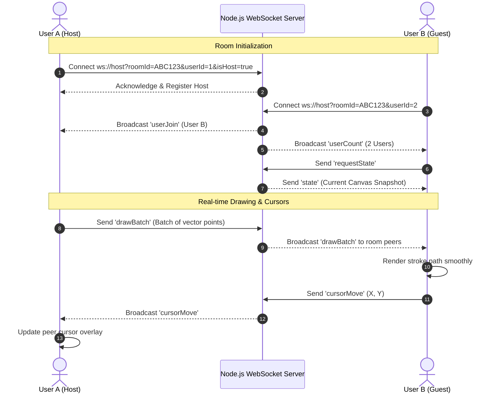

# 🎨 DoodleBoard | Real-Time Collaborative Whiteboard

[](https://nodejs.org/)
[](https://github.com/websockets/ws)
[](https://developer.mozilla.org/en-US/docs/Web/API/Canvas_API)
[](https://opensource.org/licenses/MIT)
[](https://github.com/chikaracreovations/Collaborative-Doodle-Board/pulls)

> **A high-performance, real-time multi-user digital whiteboard** built with HTML5 Canvas, WebSockets, and Node.js. Designed for brainstorming sessions, remote teamwork, visual tutoring, and creative sketching with zero latency.

---

## 🌟 Key Features

- **⚡ Real-Time Multi-User Synchronization**
  - Instant bi-directional drawing synchronization via WebSockets.
  - Smart command batching (~60 FPS) and throttling algorithms to eliminate lag.
  - Multi-user live cursor tracking with custom color indicators and name tags.

- **🏠 Room Management & Presence**
  - Generate unique 6-character room codes for private or team sessions.
  - Optional room passwords and guest permission controls.
  - Dynamic host election: automatic room ownership handover when a host disconnects.
  - Live participant counter and connection heartbeat monitoring.

- **🖌️ Creative Tooling**
  - Smooth vector stroke rendering with rounded line caps and joins.
  - Full-spectrum color picker and adjustable stroke thickness slider.
  - Non-destructive eraser tool.
  - 50-state Undo/Redo history stack with shortcut key support.

- **💾 File Import & Export**
  - Export canvas snapshots directly to high-resolution PNG format.
  - Load and render local image files onto the canvas to annotate or sketch over.

- **📱 Fully Responsive & Touch-Enabled**
  - Cross-device compatibility: works smoothly on desktops, laptops, tablets, and smartphones.
  - Native touch event support with touch-action isolation to prevent screen dragging.

- **🧘 Solo Mode**
  - Dedicated offline-first single-player canvas for private drafting, note-taking, and wireframing.

---

## 🏗️ Architecture & Communication Flow



---

## 📂 Project Structure

```
Collaborative-Doodle-Board/
├── css/                     # Modular design stylesheets
│   ├── main.css             # Design tokens, variables, navbar, footer, resets
│   ├── landing.css          # Landing page hero, CTA buttons, feature cards
│   ├── forms.css            # Create & Join room cards, toggle switches, recent rooms
│   └── whiteboard.css       # Canvas layout, toolbar, cursors, presence tags
│
├── js/                      # Modular client-side logic
│   ├── main.js              # Landing page interactions & mobile drawer
│   ├── create-room.js       # Room generation, form handling, validation
│   ├── join-room.js         # Room discovery, recent history from localStorage
│   ├── room.js              # Real-time collaborative canvas & WebSocket client
│   └── solo.js              # Solo offline sketching canvas
│
├── server/                  # Backend application
│   └── server.js            # Node.js HTTP static file server & WebSocket server
│
├── index.html               # Main landing page (GitHub Pages root entry)
├── create-room.html         # Room creation view
├── join-room.html           # Room join view
├── room.html                # Collaborative multi-user canvas view
├── solo.html                # Solo sketching canvas view
├── server.js                # Root delegator for backward-compatible cloud hosting
├── package.json             # Project metadata, scripts, dependencies
├── .gitignore               # Git ignore rules for node_modules, logs, and OS files
└── README.md                # Project documentation & portfolio overview
```

---

## 📡 WebSocket Protocol Reference

All messages are transmitted as JSON strings with a defined `type`:

| Message Type | Direction | Payload Example | Description |
| :--- | :--- | :--- | :--- |
| `drawBatch` | Client ⇄ Server | `{ type: 'drawBatch', commands: [{ x0, y0, x1, y1, color, size }], userId }` | Batched stroke coordinates for 60 FPS rendering |
| `cursorMove` | Client ⇄ Server | `{ type: 'cursorMove', x: 250, y: 340, userId, userName, color }` | Live pointer coordinate broadcasting |
| `state` | Client ⇄ Server | `{ type: 'state', state: "data:image/png;base64,...", version: 1 }` | Canvas snapshot synchronization for new joiners |
| `requestState` | Client → Server | `{ type: 'requestState', userId }` | Sent by new peers to request existing canvas state |
| `clear` | Client ⇄ Server | `{ type: 'clear', userId }` | Notifies peers to reset canvas to blank white |
| `userJoin` | Server → Client | `{ type: 'userJoin', userId, userName, color }` | Notifies room peers of a new connection |
| `userLeave` | Server → Client | `{ type: 'userLeave', userId }` | Notifies peers that a user disconnected |
| `userCount` | Server → Client | `{ type: 'userCount', count: 4 }` | Broadcasts active participant count in room |
| `hostPromotion`| Server → Client | `{ type: 'hostPromotion' }` | Informs next eligible peer they are now host |
| `ping` / `pong`| Client ⇄ Server | `{ type: 'ping' }` / `{ type: 'pong' }` | Liveness heartbeat check (every 30s) |

---

## 🚀 Getting Started

### Prerequisites

- [Node.js](https://nodejs.org/) (version 16 or later recommended)
- `npm` (comes bundled with Node.js)

### Installation

1. **Clone the repository:**
   ```bash
   git clone https://github.com/chikaracreovations/Collaborative-Doodle-Board.git
   cd Collaborative-Doodle-Board
   ```

2. **Install dependencies:**
   ```bash
   npm install
   ```

3. **Start the local server:**
   ```bash
   npm start
   ```

4. **Open in your browser:**
   ```
   http://localhost:8080
   ```
   The Node.js server automatically serves both the frontend web application and the WebSocket server on the same port!

---

## 🌐 Deployment

### 1. Static Frontend (GitHub Pages)
This repository is pre-configured for direct **GitHub Pages** deployment:
1. Push your repository to GitHub.
2. Go to **Settings** > **Pages**.
3. Under **Build and deployment**, select:
   - **Source**: `Deploy from a branch`
   - **Branch**: `main`, Folder: `/ (root)`
4. Click **Save**. Your site will be live at `https://<username>.github.io/<repo-name>/`.
> The client automatically detects if it is hosted on GitHub Pages and routes WebSocket traffic to the cloud backend!

### 2. Full-Stack / WebSocket Backend (Render / Railway)
- **Render**: Create a **Web Service**, connect this GitHub repository, and set:
  - **Build Command**: `npm install`
  - **Start Command**: `npm start`
  - **Port**: `8080` (or leave default `$PORT`)

---

## 🤝 Contributing

Contributions, bug reports, and feature requests are welcome!
1. Fork the Project
2. Create your Feature Branch (`git checkout -b feature/AmazingFeature`)
3. Commit your Changes (`git commit -m 'Add some AmazingFeature'`)
4. Push to the Branch (`git push origin feature/AmazingFeature`)
5. Open a Pull Request

---

## 📄 License

Distributed under the **MIT License**. See `LICENSE` for more information.

---

## 👨‍💻 Created By

**Chikara Creovations**
- GitHub: [@chikaracreovations](https://github.com/chikaracreovations)
